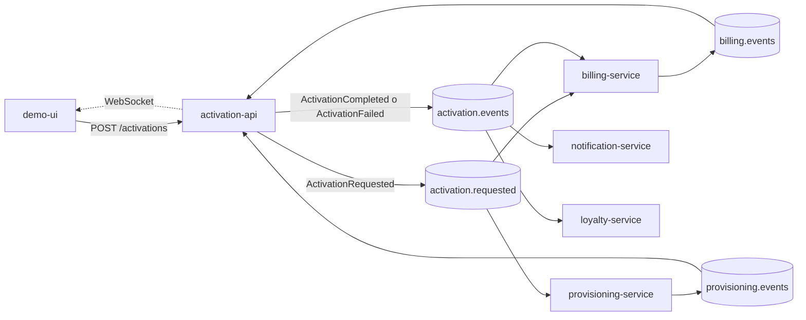

# Activación de servicios con Kafka

POC de arquitectura basada en eventos: contratar un plan dispara facturación, aprovisionamiento, notificación y analítica mediante **un solo evento en Kafka**, sin que los servicios se llamen entre sí.

Stack: **Kafka (KRaft)**, **NestJS**, **MongoDB**, **React + Vite** y **Docker Compose**.

## Cómo funciona



`crm-analytics-service` escucha los cuatro topics y registra cada evento. Si algo falla, billing anula la cuenta por su cuenta (compensación). El detalle está en [`docs/architecture.md`](docs/architecture.md).

## Requisitos

- **Docker Desktop** (con Docker Compose v2).
- Puertos libres: `3000`, `5173`, `8080`, `8025`, `1025`, `9092` y `27017`.

Node y pnpm solo hacen falta para desarrollar sin Docker.

## Levantar todo

```bash
git clone https://github.com/Gael00555/-POC_Activacion_de_Servicios_con_Kafka.git activation-poc
cd activation-poc
docker compose up -d --build
```

La primera vez construye siete imágenes y puede tardar varios minutos. Si tu conexión es lenta, construí de a un servicio:

```bash
docker compose build demo-ui
docker compose build activation-api
docker compose build billing-service
docker compose build provisioning-service
docker compose build notification-service
docker compose build crm-analytics-service
```

Cuando termine, `docker compose ps` tiene que mostrar todo en `Up`. `kafka-init` figura como `Exited (0)`, y es lo esperado: solo crea los topics y termina.

| Qué | Dirección |
|---|---|
| Interfaz de la demo | http://localhost:5173 |
| API (REST y WebSocket) | http://localhost:3000 |
| Kafka UI (topics, mensajes, consumer groups) | http://localhost:8080 |
| Mailhog (emails simulados) | http://localhost:8025 |

## Probarlo

**Desde la interfaz:** abrí http://localhost:5173, completá el formulario y contratá un plan. La timeline se llena en tiempo real. El selector *Forzar un fallo* permite simular un error en facturación o en aprovisionamiento.

**Desde la API:**

```bash
curl -X POST http://localhost:3000/activations \
  -H "Content-Type: application/json" \
  -d '{"customerId":"C-1234","planId":"FLOW-FULL"}'

curl http://localhost:3000/activations/<activationId>
```

El `POST` responde `202` con el `activationId` y el estado `PENDING`. El `simulateFailure` acepta `none`, `billing` o `provisioning`.

**La demo completa** (cinco escenarios: camino feliz, compensación, servicio caído, escalado y replay) está en [`docs/demo-script.md`](docs/demo-script.md).

## Servicios

| Servicio | Rol |
|---|---|
| `activation-api` | Entrada REST y WebSocket. Junta los resultados y decide `ACTIVE` o `FAILED`. |
| `billing-service` | Crea la cuenta de facturación y la anula si la activación falla. |
| `provisioning-service` | Simula el aprovisionamiento (1 a 3 s). |
| `notification-service` | Envía el email de bienvenida o de error a Mailhog. |
| `crm-analytics-service` | Registra todos los eventos. No publica nada. |
| `loyalty-service` | Opcional. Suma puntos leyendo el historial desde el principio. |
| `demo-ui` | Formulario y timeline en vivo. |

`loyalty-service` no arranca con el `docker compose up` normal. Se pide con su perfil:

```bash
docker compose --profile loyalty up -d --build loyalty-service
```

## Garantías

Todos los consumidores usan `libs/kafka-toolkit`:

- **Idempotencia:** un evento repetido se descarta (el `eventId` se registra en la misma transacción de Mongo que el efecto).
- **Reintentos:** 3 reintentos con espera de 1, 2 y 4 segundos.
- **Dead Letter Queue:** tras el último fallo, el mensaje va a `<topic>.dlq` con el motivo en los headers, y el resto del flujo sigue.

## Estructura

```
.
├── apps/
│   ├── activation-api/
│   ├── billing-service/
│   ├── provisioning-service/
│   ├── notification-service/
│   ├── crm-analytics-service/
│   ├── loyalty-service/
│   └── demo-ui/
├── libs/
│   ├── contracts/        tipos de eventos, sobre común y nombres de topics
│   └── kafka-toolkit/    idempotencia, reintentos y DLQ
├── docker/               Dockerfiles y script de creación de topics
├── docs/                 arquitectura y guion de demo
└── docker-compose.yaml
```

## Configuración

Cada servicio lee su configuración de variables de entorno. Si no están, usa valores para correr en `localhost`.

| Variable | Para qué | Valor en Docker |
|---|---|---|
| `KAFKA_BROKERS` | Direcciones de Kafka | `kafka:19092` |
| `KAFKA_CLIENT_ID` | Identificador del cliente | nombre del servicio |
| `KAFKA_GROUP_ID` | Consumer group | nombre del servicio |
| `MONGO_URI` | Base de datos del servicio | `mongodb://mongo:27017/<base>?directConnection=true` |
| `MAIL_HOST`, `MAIL_PORT` | SMTP (solo notification) | `mailhog`, `1025` |
| `VITE_API_URL` | Dirección de la API vista desde el navegador (se fija al construir la UI) | `http://localhost:3000` |

## Desarrollo sin Docker para los servicios

Se necesita Node 20 o superior y pnpm. Con la infraestructura en Docker y los servicios en tu terminal:

```bash
docker compose up -d kafka kafka-init kafka-ui mongo mailhog
pnpm install
pnpm --filter @activation-poc/contracts run build
pnpm --filter @activation-poc/kafka-toolkit run build

# una terminal por servicio, por ejemplo:
cd apps/activation-api && pnpm run start:dev
```

La UI se levanta con `cd apps/demo-ui && pnpm run dev`. No corras los servicios locales y los contenedores a la vez: competirían por los mismos puertos y por los mismos grupos de Kafka. Si cambiás algo en `libs/`, volvé a compilarlo con `pnpm --filter <paquete> run build`.

## Problemas comunes

- **`port is already allocated` en 3000 o 5173:** hay otro proceso o contenedor usando ese puerto. Revisalo con `docker ps` y cerrá los servidores de desarrollo.
- **Un servicio no recibe eventos apenas arranca:** esperá unos segundos. Hasta que se une a su consumer group (aparece `Consumer has joined the group`), no consume.
- **`not primary` desde Mongo:** el replica set todavía se está inicializando. Esperá a que `docker compose ps` muestre `mongo` como `healthy`.
- **Empezar de cero** (borra los datos de este proyecto, no los de otros): `docker compose --profile loyalty down -v` y después `docker compose up -d --build`.

## Límites conocidos

Es una POC pensada para correr en local: sin autenticación ni TLS, y sin outbox transaccional. Esos y otros límites están listados en [`docs/architecture.md`](docs/architecture.md#límites-conocidos-de-la-poc).
